# Análisis de anuncios de Airbnb en 10 ciudades

Análisis exploratorio de [279712] anuncios de Airbnb en Bangkok, Cape Town, Hong Kong, Istanbul, Mexico City, New York, Paris, Rio de Janeiro, Roma y Sydney.

## Resumen

- **La capacidad es lo que más explica el precio**: huéspedes y dormitorios tienen la mayor correlación con el precio en las 10 ciudades. La ubicación influye en segundo lugar y las valoraciones casi no influyen.
- **El tamaño dispara el precio total, pero no siempre el precio por persona**: en seis ciudades el precio por huésped baja en alojamientos grandes; en otras cuatro vuelve a subir en los muy grandes.
- **Ubicación, calidad y limpieza**: los barrios mejor puntuados en ubicación tienden a ser más caros, y en la valoración global pesan más la limpieza y la relación calidad-precio que la ubicación.
- **New York es un mercado distinto**: dos de cada tres anuncios exigen 30 noches o más.
- **Los alojamientos completos acumulan más reseñas** que las habitaciones, sobre todo en Istanbul.

## Datos y preparación

**Fuente:** archivo Listings.csv (279.712 anuncios y 33 columnas). Se conservaron las columnas relevantes para el análisis y se descartaron las de texto libre o poco informativas.

**Limpieza aplicada:**

- Se eliminaron 165 anuncios sin datos de anfitrión y 113 con precio 0.
- Los precios atípicos se detectaron por ciudad con el método IQR sobre el logaritmo del precio, y se eliminaron [X] anuncios.
- Se eliminaron los mínimos de noches superiores a 365 (valores no realistas).
- Los dormitorios vacíos (10,5 %) se imputaron con la mediana por ciudad, tipo de alojamiento y capacidad.
- Las categorías de tipo de propiedad con menos de 500 anuncios se agruparon en «Others».
- La columna `district` se descartó porque solo está informada en New York.

**Importante:** los precios están expresados en la **moneda local de cada ciudad**. Por eso las comparaciones entre ciudades se hacen con un precio relativo (1,00 = mediana de la ciudad), no con valores absolutos.

## 1. ¿Qué factores explican el precio?

La **capacidad** es el factor dominante: la correlación del precio con huéspedes y dormitorios va de 0,31 a 0,68 y es la más alta en todas las ciudades, sobre todo en Sydney y Cape Town. Con un huésped se paga entre 0,33 y 0,59 veces la mediana de la ciudad; con siete o más, entre 2,1 y 4,9 veces.

Las valoraciones apenas influyen (0,04 a 0,16) y la ubicación lo hace de forma moderada (hasta 0,23 en Roma). En Hong Kong, un mínimo de noches más alto se asocia a precios menores (-0,24).

La habitación compartida es la más barata en todas partes. Sorprende que la **habitación de hotel** supere al alojamiento completo en cinco ciudades (Bangkok, Cape Town, Mexico City, New York y Paris), aunque esta categoría tiene pocos anuncios.

*Figura 1A. Correlación de Spearman entre el precio y cada variable, por ciudad.*

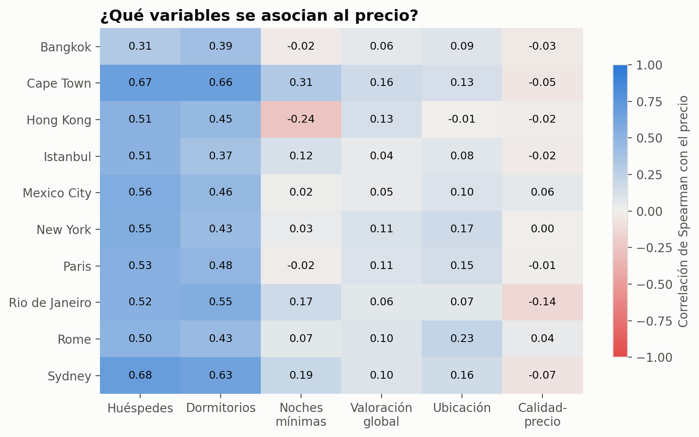

*Figura 1B. Precio relativo a la mediana de la ciudad según el número de huéspedes.*

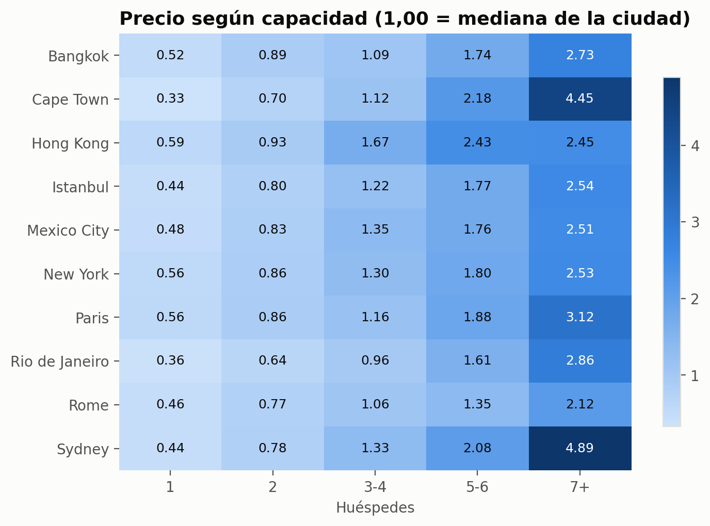

*Figura 1C. Precio mediano por tipo de alojamiento (moneda local de cada ciudad).*

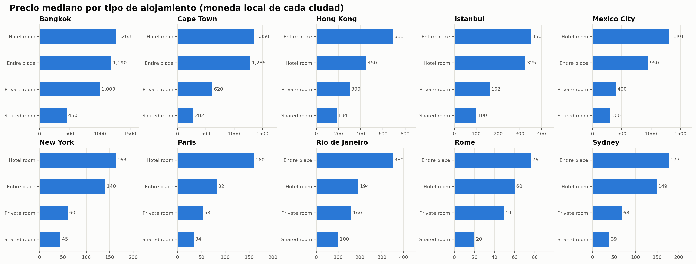

## 2. ¿Dónde está la mejor relación valoración/precio?

A nivel de barrio, la relación entre precio y puntuación calidad-precio es débil: hay barrios caros con valoraciones muy altas y baratos con valoraciones bajas. Los barrios más baratos muestran más dispersión.

Entre los barrios más baratos que su ciudad con puntuación en el 25 % superior, destaca **Cape Town** (siete de los diez primeros), seguida de New York (Woodhaven y Bay Ridge) y Mexico City (La Magdalena Contreras). Las puntuaciones del top 10 van de 9,61 a 9,77, diferencias pequeñas, por lo que el orden exacto debe leerse con prudencia.

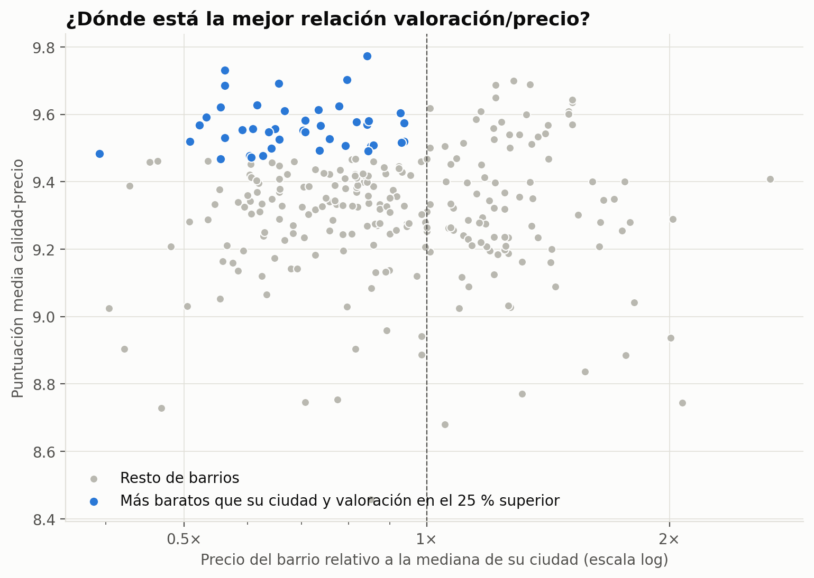

*Figura 2A. Precio relativo y puntuación calidad-precio de cada barrio (mínimo 50 anuncios con valoración).*

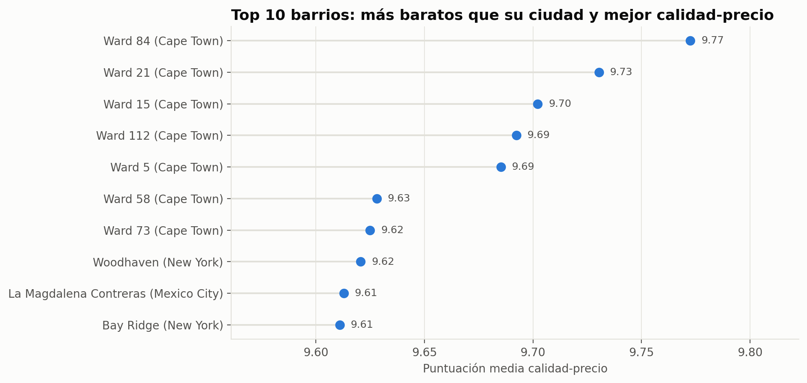

*Figura 2B. Los diez barrios más baratos que su ciudad con mejor puntuación calidad-precio.*

## 3. ¿Se paga por la ubicación?

Los mapas muestran que, en ciudades como Paris y Roma, los precios más altos se concentran en el centro y se enfrían hacia la periferia.

A nivel de barrio, existe una relación **moderada y positiva** entre la puntuación de ubicación y el precio relativo (Spearman = 0,47). Es una asociación, no prueba que la ubicación cause el precio. La relación es más débil a nivel de anuncio individual (0,02 a 0,23), porque al agrupar por barrio se promedia gran parte del ruido.

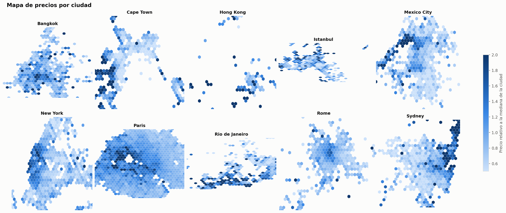

*Figura 3A. Precio relativo a la mediana de la ciudad, por zonas.*

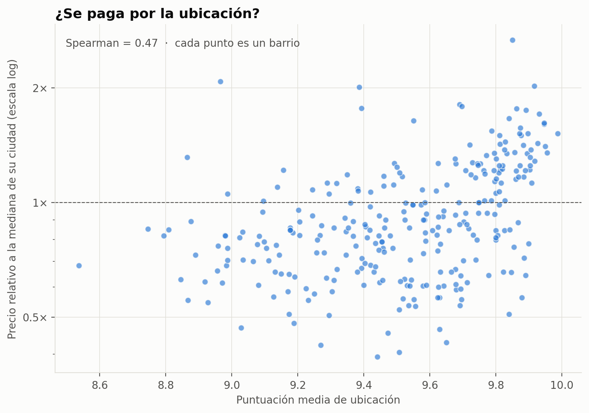

*Figura 3B. Puntuación de ubicación frente a precio relativo; cada punto es un barrio.*

## 4. ¿Cuánto cuesta cada huésped?

Los alojamientos para una sola persona salen más caros por persona que la mediana de su ciudad en casi todas partes (0,95 a 1,50). A partir de ahí hay dos patrones:

- **Descuento por tamaño** en seis ciudades (Bangkok, Hong Kong, Istanbul, Mexico City, New York y Roma): el precio por huésped baja hasta 0,55-0,79 veces la mediana en los alojamientos de siete o más.
- **Forma de U** en cuatro (Cape Town, Sydney, Paris y Rio): el mínimo está en 3-4 huéspedes y vuelve a subir en los muy grandes (1,51 en Cape Town y 1,47 en Sydney), posiblemente por villas o casas de lujo.

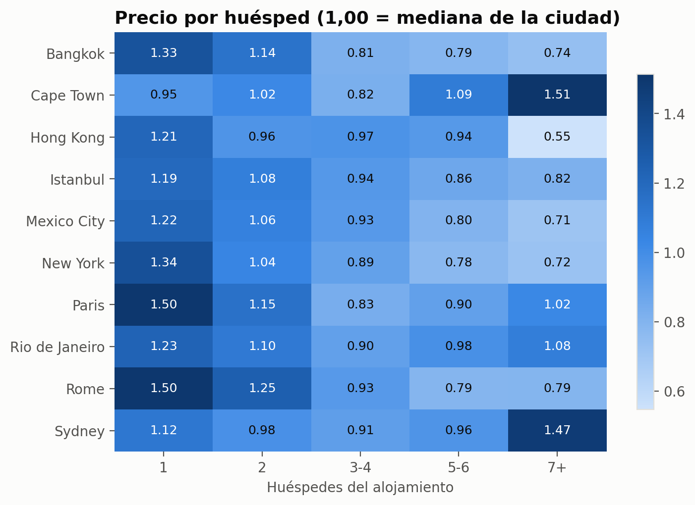

*Figura 4. Precio por huésped relativo a la mediana de la ciudad, según capacidad.*

## 5. ¿Qué puntuación pesa más en la valoración global?

**Limpieza** (0,59) y **calidad-precio** (0,61) tienen un peso similar en la valoración global, mientras que la **ubicación** pesa menos en todas las ciudades (0,25 a 0,44). Cambia según la ciudad: la limpieza destaca más en Hong Kong, Rio y Mexico City, y la calidad-precio en Bangkok y Roma. Solo se analizaron tres de las seis puntuaciones parciales, y estas están relacionadas entre sí, por lo que la correlación no mide importancia causal.

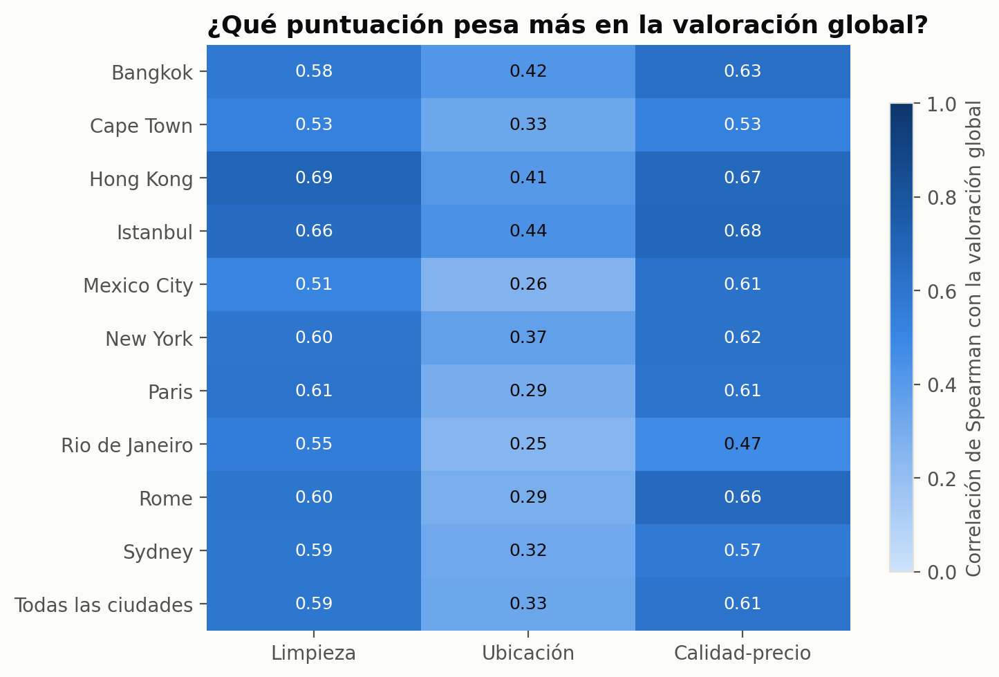

*Figura 5. Correlación de Spearman entre la valoración global y las puntuaciones de limpieza, ubicación y calidad-precio.*

## 6. El mercado de larga estancia

**New York** es un caso aparte: el 66,8 % de sus anuncios exige 30 noches o más. En el resto de ciudades el peso va del 1,6 % al 11,3 %. En Hong Kong el mercado se concentra en mínimos de 28 noches, justo por debajo de nuestro corte, por lo que su cifra (10,8 %) queda por debajo de la realidad.

En seis ciudades la larga estancia sale **más barata por noche**: mucho en Roma (0,65 frente a 1,02), Cape Town y Mexico City, moderado en Hong Kong y Bangkok, y casi nada en Rio e Istanbul. En Paris y Sydney no hay diferencia. En New York, donde la larga estancia es la norma, es la corta la que sale algo más barata. No se ha controlado el tipo de alojamiento, que podría explicar parte de estas diferencias.

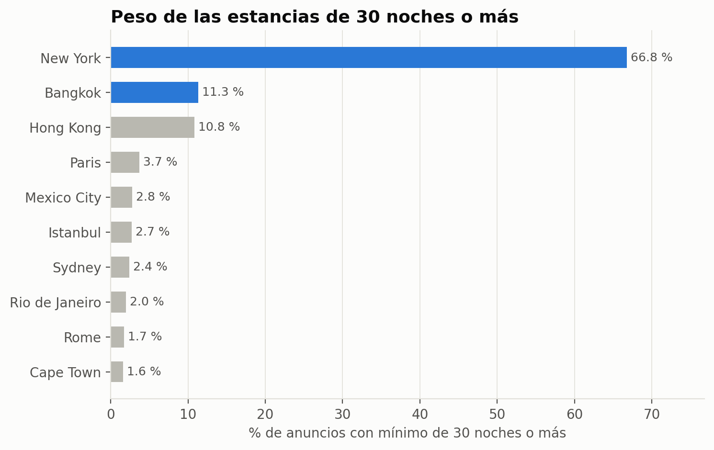

*Figura 6A. Porcentaje de anuncios con un mínimo de 30 noches o más, por ciudad.*

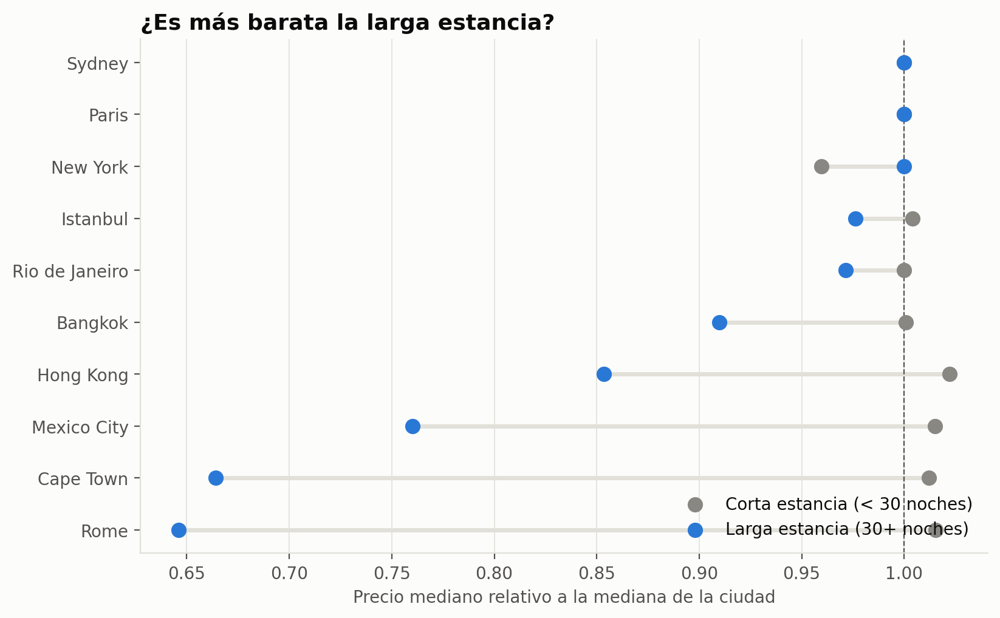

*Figura 6B. Precio mediano relativo de los anuncios de corta y larga estancia.*

## 7. Anuncios sin reseñas

El **alojamiento completo** es el que menos anuncios sin reseñas tiene en casi todas las ciudades (del 18 % en Roma al 43 % en Istanbul), mientras que las habitaciones privadas y compartidas se disparan en varias (en Istanbul, 66 % y 81 %). New York es la más uniforme (23 % a 31 %).

Según el precio, la relación no es lineal: el mínimo está en los precios medios (28-29 %) y sube en los más baratos (34 %) y, sobre todo, en los más caros (**43 % con el doble de la mediana o más**). No podemos saber con estos datos si esos anuncios están inactivos o simplemente no tienen demanda.

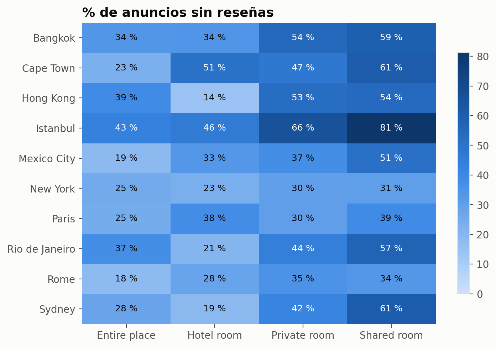

*Figura 7A. Porcentaje de anuncios sin reseñas por ciudad y tipo de alojamiento.*

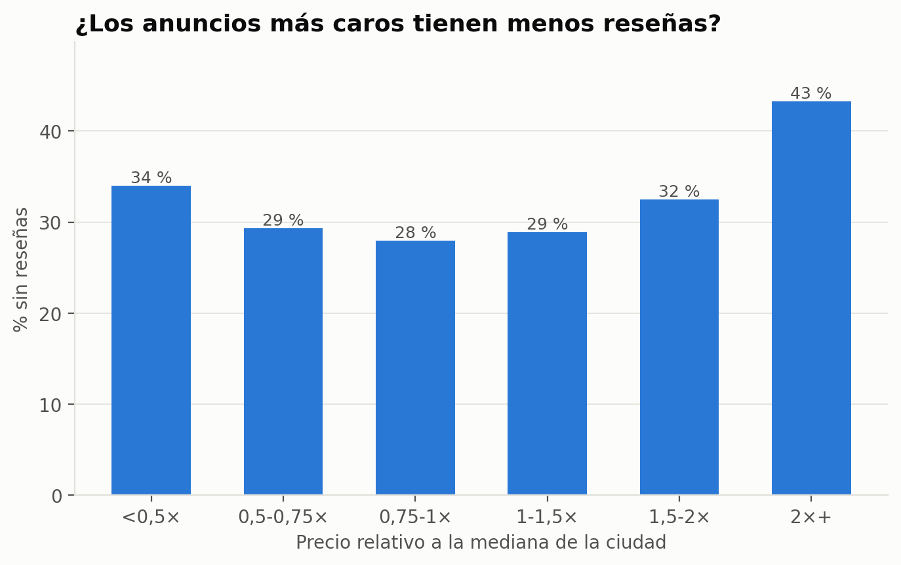

*Figura 7B. Porcentaje de anuncios sin reseñas según el precio relativo.*

## Conclusiones

1. El tamaño del alojamiento (huéspedes y dormitorios) es el principal determinante del precio en todas las ciudades.
2. La ubicación aporta un efecto moderado; la valoración, casi ninguno.
3. Las dinámicas de cada mercado difieren: New York se rige por la larga estancia, y las ciudades se reparten entre descuento por tamaño y precios premium en los alojamientos grandes.
4. Hay oportunidades de buena relación calidad-precio en barrios concretos de Cape Town, New York y Mexico City.

## Limitaciones

- Precios en moneda local: no se comparan valores absolutos entre ciudades.
- Se desconoce la fecha de captura de los datos; los precios pueden reflejar un momento concreto.
- Los resultados son asociaciones, no relaciones causales.
- Algunas categorías (habitación de hotel, habitación compartida) tienen pocos anuncios en ciertas ciudades.
- Los dormitorios vacíos se imputaron; los anuncios sin reseñas no se pueden distinguir entre nuevos e inactivos.
